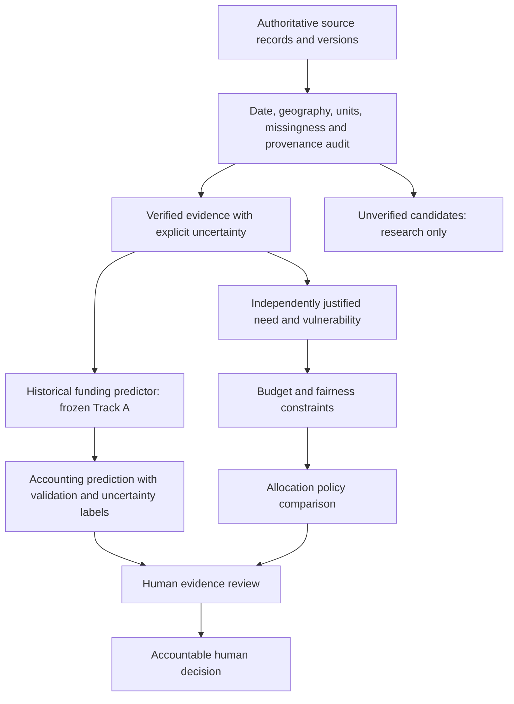

# Research architecture and evidence boundaries

This is the selected separation of responsibilities, not evidence that every
component is operationally validated. Funding is an accounting prediction, not
the need variable driving allocation. Track A remains retrospective. The current
allocation implementation uses synthetic needs; real-need linkage is incomplete.
Unverified severity/exposure candidates cannot enter an accepted model. Missing
observations remain missing and can trigger abstention or human review.
