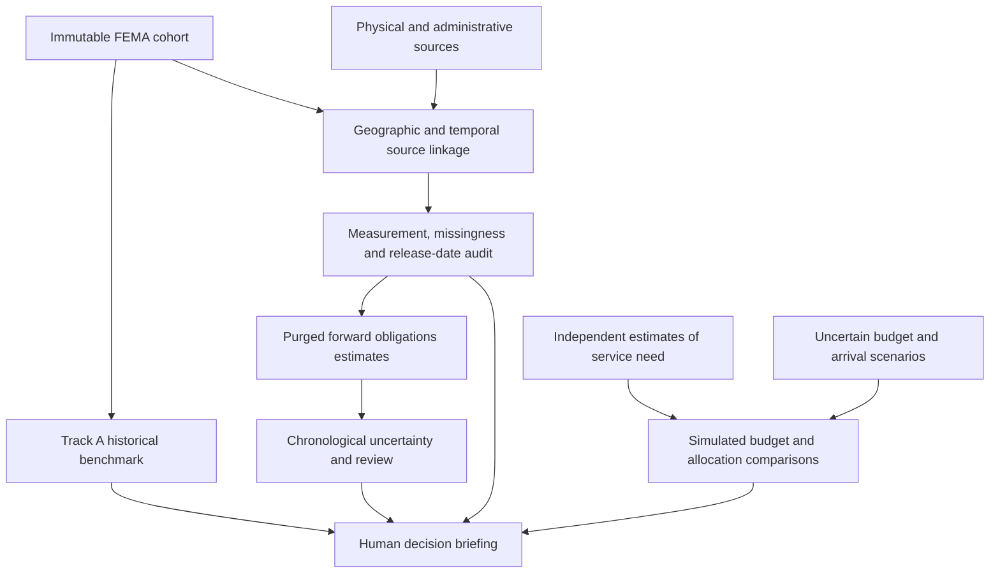

# Research framework

| Module | Output | Evidence standard |
| --- | --- | --- |
| Historical benchmark | Funding bands and amounts | Reproduced frozen historical outputs and artifact provenance |
| Physical evidence | Hazard measurements and source match status | Official measurements, reproducible matching and explicit missingness |
| Forward estimation | Exploratory funding estimates and uncertainty | Purged dates and event groups, earlier-only tuning, conditional coverage |
| Allocation | Feasible service-unit options with equity and delay outcomes | Simulation with independent need, fixed scenarios and explicit weights |
| Human briefing | Evidence status, uncertainty and policy comparisons | Review required for operational interpretation and action |

The original reinforcement learning notebook adjusts base ML recommendations under staged budget releases. Its reward is tied to the archived historical funding outcome. The continuation preserves the staged-budget idea and evaluates service priorities using independent synthetic need. See [original RL notebook](../reinforcement_learning.ipynb), [reproducible human briefing](../analysis/thesis_demo.py).

## Historical funding label eligibility for forward research

Versioned forward candidates must track whether the source could have observed an obligation. The public Mission Assignments v2 history starts October 1, 2012. The 223 earlier recorded zeros are eligible for historical Track A reproduction and excluded from coverage-screened forward training unless a definition-compatible complete ledger can verify them. Later records with absent public actions need a separate completeness audit. A fixed-horizon net obligation and an eventual obligation are distinct forecasting endpoints. [Coverage evidence](continuous/coverage/REPORT.md).

The research workflow tracks formula, signed action keys, elapsed outcome horizon, reporting buffer and documented release vintage separately. The full current snapshot allows retrospective fixed-horizon auditing and excludes action-free records from the standardized label evidence set. The two-day water simulator extends the allocation stress tests with inventory and transportation constraints. The tested recourse policies remain research comparators. [Historical maturity](continuous/horizons/REPORT.md), [constrained water simulation](continuous/water_recourse/REPORT.md).

The full-page retrospective geography is a separately versioned input. It retains every older date-matched county key and adds verified archived links. The early documentary evidence module checks the publication clock, recorded edit clock, case identity and affirmative program content before proposing temporal feature eligibility. Episode purges may tighten when new physical links connect cases. The matched retrospective replay uses a shared purge to isolate input coverage effects. [Complete geography](continuous/complete_geography/REPORT.md), [historical publication fields](continuous/announcement_fields/REPORT.md).
