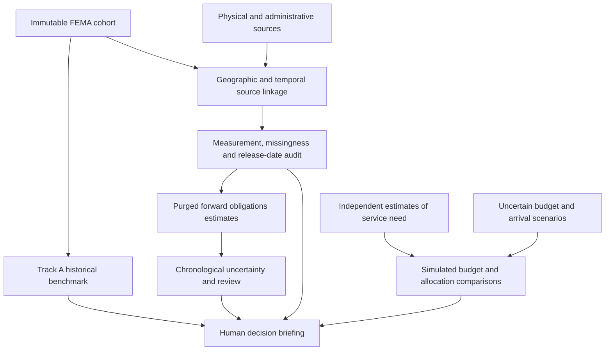

# Research framework

| Module | Output | Evidence standard |
| --- | --- | --- |
| Historical benchmark | Funding bands and amounts | Reproduced frozen historical outputs and artifact provenance |
| Physical evidence | Hazard measurements and source match status | Official measurements, reproducible matching and explicit missingness |
| Forward estimation | Exploratory funding estimates and uncertainty | Purged dates and event groups, earlier-only tuning, conditional coverage |
| Allocation | Feasible service-unit options with equity and delay outcomes | Simulation with independent need, fixed scenarios and explicit weights |
| Human briefing | Evidence status, uncertainty and policy comparisons | Review required for operational interpretation and action |

The original reinforcement learning notebook adjusts base ML recommendations under staged budget releases. Its reward is tied to the archived historical funding outcome. The continuation preserves the staged-budget idea and evaluates service priorities using independent synthetic need. See [original RL notebook](../reinforcement_learning.ipynb), [reproducible human briefing](../analysis/thesis_demo.py).

## Historical funding label eligibility for forward research

Versioned forward candidates must track whether the source could have observed an obligation. The public Mission Assignments v2 history starts October 1, 2012. The 223 earlier recorded zeros are eligible for historical Track A reproduction and excluded from coverage-screened forward training unless a definition-compatible complete ledger can verify them. Later records with absent public actions need a separate completeness audit. A fixed-horizon net obligation and an eventual obligation are distinct forecasting endpoints. [Coverage evidence](continuous/coverage/REPORT.md).

The research workflow tracks formula, signed action keys, elapsed outcome horizon, reporting buffer and documented release vintage separately. The full current snapshot allows retrospective fixed-horizon auditing and excludes action-free records from the standardized label evidence set. The two-day water simulator extends the allocation stress tests with inventory and transportation constraints. The tested recourse policies remain research comparators. [Historical maturity](continuous/horizons/REPORT.md), [constrained water simulation](continuous/water_recourse/REPORT.md).

The full-page retrospective geography is a separately versioned input. It retains every older date-matched county key and adds verified archived links. The early documentary evidence module checks the publication clock, recorded edit clock, case identity and affirmative program content before proposing temporal feature eligibility. Episode purges may tighten when new physical links connect cases. The matched retrospective replay uses a shared purge to isolate input coverage effects. [Complete geography](continuous/complete_geography/REPORT.md), [historical publication fields](continuous/announcement_fields/REPORT.md).

An archived original document can support an early feature when its exact content has a verified capture by the required horizon. The evidence module records the visible release claim and each independently timestamped body separately. The older pilot found substantive post-release editing and a small overlap with elapsed funding-label support. The DOE disturbance-duration prior remains a separate exploratory method for a service reporting endpoint. Its evidence does not justify adoption in the allocation or funding modules. [Earlier content provenance](continuous/older_announcements/REPORT.md), [service-endpoint experiment](continuous/disturbance_duration/REPORT.md).

Before a documentary forecast is fit, the framework now screens authentic feature versions and elapsed target availability jointly by chronological origin, including the count of independent upper-band groups. The expanded earlier archive improves verified feature coverage while both modeling gates remain closed. A similar source-level screen now governs future county outage simulation. It keeps an observed threshold drop, the count at the prediction horizon, and missing observation windows distinct. [Documentary model audit](continuous/documentary_extension/REPORT.md), [county outage endpoint audit](continuous/county_outages/REPORT.md).

Historical amounts require exact declaration scope, complete signed-action history and a comparable elapsed cutoff even when aggregate official amounts are available. The precoverage audit substantiates the gate with documented obligation revisions and assignment identifiers. The four-year county trajectory benchmark adds a separately versioned auxiliary comparator that uses entry-time observed counts and measures sustained threshold status. Weighted synthetic trajectories did not meet its integration criterion. [Precoverage evidence gate](continuous/precoverage_documentary/REPORT.md), [county trajectory comparator](continuous/sustained_outage/REPORT.md).

Trade-offs between funding record coverage and completeness remain explicit in the supporting audit. Specific recipient records can verify one assignment or billing stage while leaving the full elapsed declaration balance unknown. Auxiliary wind and outage models apply location, timing, verified outcome support and independent storm-count checks before a fit. [Accounting scope](continuous/component_accounting/REPORT.md), [wind linkage gate](continuous/county_wind_exposure/REPORT.md).

The wind and outage module now registers its geographic storm panel before outcome acquisition and tests independent held groups before new process simulation. The humanitarian module distinguishes respondent-reported needs, service receipt and occupancy or capacity fields. Scenario benchmarking can use the published measurements and their reported uncertainty, with the source population and event timeframe retained. Allocation-policy evaluation requires additional matched observation of demand, intervention and delivery. [Wind and outage screen](continuous/storm_outage_panel/REPORT.md), [humanitarian source audit](continuous/humanitarian_source/REPORT.md).

The coverage-aware amount module accepts a versioned provisional eventual endpoint or separately verified elapsed signed actions. It records unobserved labels explicitly and retains chronological real-only comparators. The nested hazard gate is an exploratory complement architecture. Candidate activation depends on training-only paired overall and tail errors, earlier independent episode support and later confirmation. The separate simulation module accepts service-specific survey anchors and reports overall, high-vulnerability and lowest-zone outcomes side by side. Its assumptions, synthetic seeds and inventory constraints accompany the policy summary. [Coverage-aware funding](continuous/coverage_specialists/REPORT.md), [multi-service decisions](continuous/service_scenarios/REPORT.md).

The coastal nowcast reference uses datum-consistent observed residual persistence alongside astronomical tide. Its strictly retrospective evidence supplies validation targets for a future physical module, conditional on independently supported storm groups and available earlier inputs. The simulation briefing can expose a geographic service floor and report the associated total and subgroup coverage differences using the same staged inventories. [Tide diagnostics](continuous/tidal_residual/REPORT.md), [service protection](continuous/service_floors/REPORT.md).

## Integrated research and decision evidence

| Component | Output and unit | Current role | Gate for downstream use |
| --- | --- | --- | --- |
| Frozen Track A | Historical funding band and reconstructed amount in USD | Immutable historical reporting reference | Forward or operational claims require a separate evaluation |
| Signed-obligation real-only and fixed 20× | Comparable-window historical funding estimate in USD and raw exceedance score | Separately versioned exploratory comparison | Independent mature outcomes, audited prediction-time features, matched uncertainty and a frozen review policy |
| Coastal observations and diagnostics | Station residual in meters at a specified lead and local datum | Retrospective physical baseline and sensitivity | Stable issue-time provenance and later independent geographical and storm validation |
| Physics simulation and hybrid | Model-generated residual in meters | Preserved auxiliary experiment | Independently supported improvement against persistence and real-only statistical predictions |
| Transport and allocation optimizer | Simulated service fractions and shortages by outcome and objective | Human-review display for stated synthetic trade-offs | Observed service units, request and delivery histories, and defensible operational comparisons |

A decision briefing can show the modules side by side with endpoint, uncertainty, issue clock and provenance. Signed dollars are a funding outcome, and survey quantities and gauge forecasts have independent units. Any future link from a calibrated physical prediction to service demand needs observed exposure and need under a matched time and place. Any actual constraint linking dollars to transport resources needs a verified procurement and delivery model. At the present evidence level, the optimizer consumes survey-informed hypothetical requests, and the historical funding predictions appear only as a separate context panel. [Funding influence](continuous/weight_influence/REPORT.md), [coastal evidence](continuous/coastal_transfer/REPORT.md), [transport frontier](continuous/transport_pareto/REPORT.md).
