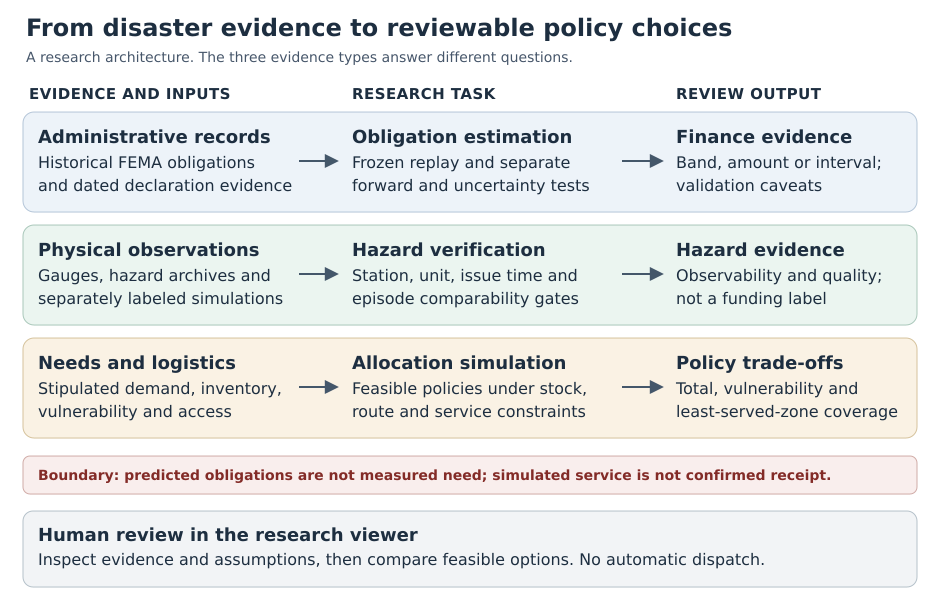
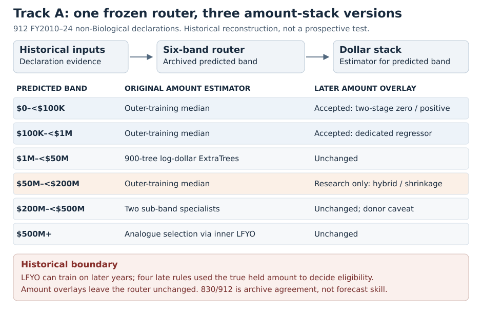
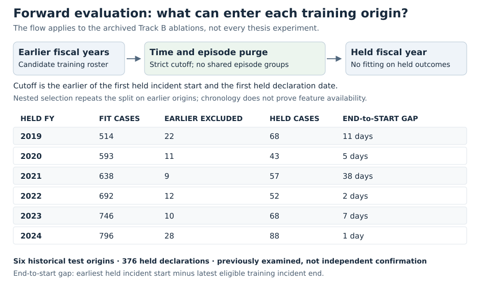
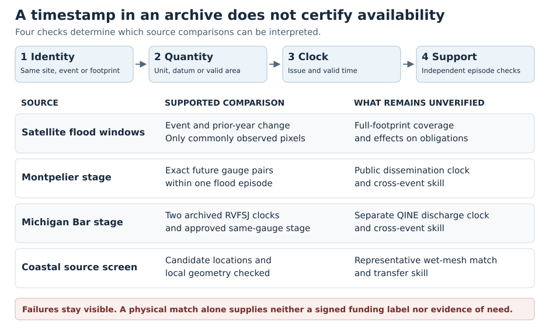
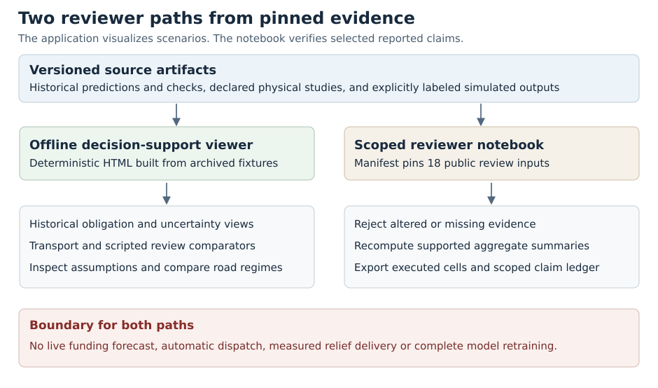
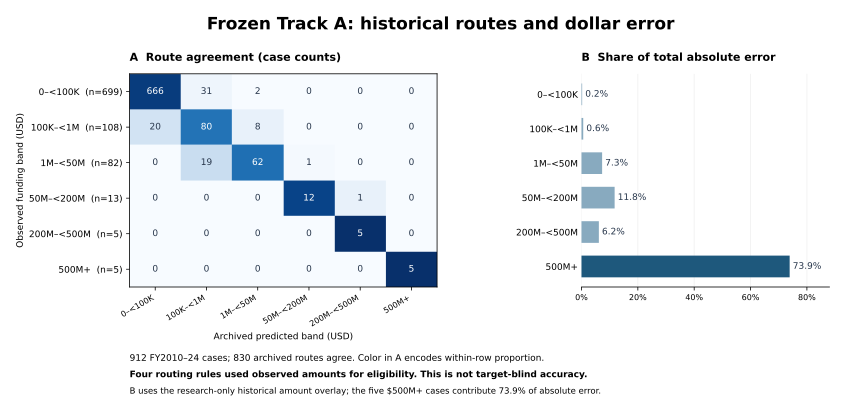
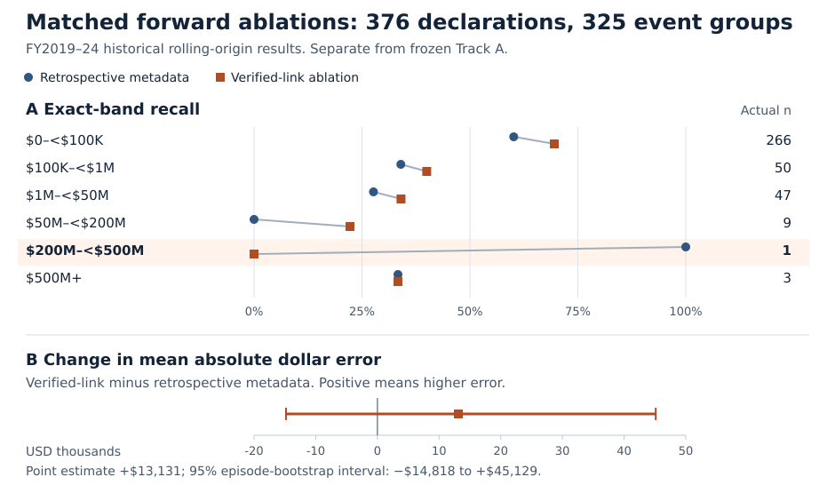
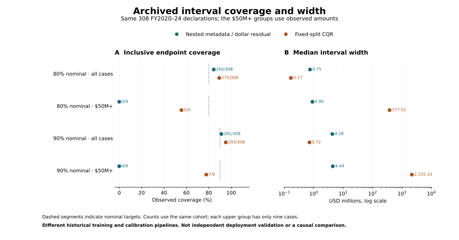
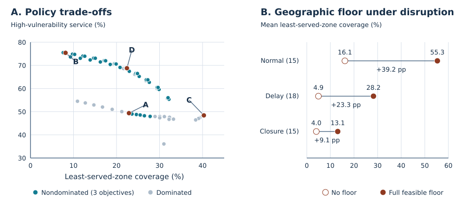

# AI-Assisted Decision-Support Framework for Disaster Relief Resource Allocation Under Uncertainty

Leon Marienga | Master's thesis working manuscript | Supervisor-review draft | Archived benchmark and retrospective validation

## Abstract

Disaster relief decisions must often be made before the extent of damage, available resources or unmet needs is known. Historical government obligations provide a record of administrative action, but not a direct measure of need. This thesis develops a research framework that keeps those quantities separate. It reconstructs a historical FEMA Mission Assignment benchmark, evaluates whether physical and administrative evidence improves forward obligation prediction, and compares relief allocation policies in simulations informed by household survey evidence. The frozen six-band benchmark reproduced 830 correct classifications in 912 cases (91.01%); the reported amount overlay reproduced mean absolute error of $5.015 million. These are retrospective reconstruction results: the final historical routing includes rules whose eligibility used the held record's true obligation amount. In a matched forward comparison of 376 declarations, additional hazard linkages improved raw accuracy but reduced balanced accuracy, with no clear improvement in dollar error. An exploratory 20× weighting strategy reduced high-obligation error on an examined signed-action cohort, but its uncertainty and false alerts limit use. The coastal hybrid did not consistently outperform its real-data baselines. In 48 simulated transport scenarios, a geographic service floor reduced the worst geographic shortfall at the cost of coverage in the highest-vulnerability zones. The principal contribution is a reproducible process for testing these components and withholding claims when timing, measurement or independent validation is inadequate. The evidence supports use as a research and scenario-comparison framework, not as an operational allocation system.

## Chapter 1 Introduction

After a disaster, a relief team may know which counties were designated for assistance without knowing which roads are passable or which households lack safe water. Even when those observations become available, the team may not know what stock will arrive before the next dispatch. A single estimate cannot resolve these different uncertainties. An estimate of historical obligations can inform resource planning, but it cannot say where to send water or whose request should be served first. Those decisions also depend on observed needs, available inventory, transport conditions and priorities that a decision-maker can inspect and change.

The study has five research questions and matching objectives.

1. **RQ1.** Can the historical six-band FEMA benchmark be reproduced, and does time-valid physical or exposure evidence improve forward obligation prediction?
2. **RQ2.** Can authentic hazard data, training-only augmentation, or physics-informed transfer improve a declared physical or rare-obligation target on independent episodes?
3. **RQ3.** How well do uncertainty intervals and review flags describe risk, particularly for rare and large obligations?
4. **RQ4.** How do feasible policies trade off total service, high-vulnerability service and least-served-zone coverage under inventory and transport constraints?
5. **RQ5.** Can a reproducible human-in-the-loop prototype make uncertainty, evidence provenance and policy trade-offs visible without using historical obligations as measures of need?

**Figure F1.** Administrative obligations are an accounting reference, physical measurements verify hazard quantities, and service simulations use separately specified needs and constraints. The research viewer presents these outputs with their assumptions. It does not authorize dispatch or equate a simulated allocation with supplies received.

The research concerns U.S. FEMA declarations in the historical benchmark. Auxiliary physical studies use event-specific measurement domains; the allocation study uses separate survey-informed synthetic scenarios. None is treated as a representative sample of global disasters. The framework is intended to show which findings are reconstructible, which comparisons are exploratory and which operational claims the evidence does not support.

## Chapter 2 Literature and conceptual framework

### From hazard observation to assistance

Remote sensing can document changes in surface water over long periods (Pekel et al., 2016), and event-focused mapping can estimate population exposed to observed flood extent (Tellman et al., 2021). For this thesis, those two designs answer different questions. A monthly classification can capture wet conditions that do not belong to the disaster, and clouds or sensor coverage can remove observations. An event footprint requires alignment in place and time plus a credible corroborating observation. Even a validated footprint over a populated area estimates exposure, not households reporting unmet needs. The thesis therefore tracks observations, inferred footprints, exposure proxies and humanitarian needs in separate data fields.

FEMA Mission Assignments document authorized federal assistance and related obligations (FEMA, 2024). Signed revisions and deobligations can change the net record after issuance. Economic damage, a recipient agency's expenses and payments are not substitutes for the signed declaration-level obligation endpoint. The reporting window, action scope and documentary chronology affect what a valid model label represents.

### Rare events and uncertainty

Oversampling can change the emphasis a model gives to rare outcomes (Chawla et al., 2002). Regression adaptations such as SMOGN interpolate nearby observations and add controlled noise (Branco et al., 2017). The issue here is not only class imbalance. A small number of independent disasters may supply the compatible observations from which a generator could learn. Repeating, reweighting or interpolating a few cases does not increase the number of independent episodes. A physically plausible simulator can instead be tested against the same physical quantity measured on independent events, without generating purported historical monetary labels.

Prediction intervals are useful when they reveal limits, not when their nominal coverage is mistaken for protection in the most consequential cases. Conformal methods rely on conditions that can be weakened under shifts between training and evaluation populations (Barber et al., 2023). The present design evaluates chronological empirical coverage, with separate results for the funding tail. When a pooled interval appears adequate but misses the cases of greatest concern, that finding limits the admissible use of the estimator.

### Humanitarian logistics and equity

Humanitarian logistics has emphasized the cost that delays and deprivation impose on affected people, not merely the expense of moving supplies (Holguín-Veras et al., 2013). The USVI household assessments demonstrate that service-related survey evidence can be collected separately from financial accounts. The study uses such evidence to inform plausible demand scenarios, while keeping simulated dispatch and fulfillment separate from observed receipt. Distinct constraints for stock, cargo, route throughput and timing help make feasible service options comparable. The intended role of the prototype is to show the consequences of different objectives, without choosing a social priority on behalf of responders or communities.

## Chapter 3 Methodology

[Appendix D](#appendix-d-implemented-formulations) gives the versioned equations for the distinct financial, verification and simulated-service tasks implemented here.

### 3.1 Historical estimand and covered cohort

The frozen FY2010–2024 workbook contains 971 declarations, of which 59 Biological records are outside the 912-case router population. The archived benchmark uses bands with lower bounds of $0, $100,000, $1 million, $50 million, $200 million and $500 million. The original workbook's negative totals are clipped to zero under the original convention. Four retained prediction-component archives are combined with the fixed overlay; files, keys, target values and amounts are checked against the archived outputs. Leave-fiscal-year-out folds can include years subsequent to the held fiscal year. This benchmark is consequently a reproducibility target and cannot be used to establish decision-time forecast accuracy.

**Table T1.** Selected nonmissing historical linkages in the frozen FY2010–24 feature audit. The first row uses all historical declarations (including Biological records); other rows use the stated incident type. A missing value means this audit did not populate the feature, not an absence of hazard. These counts are neither decision-time coverage nor an assessment of forecasting accuracy.

| Source or feature | Denominator cohort | Linked / total | Time basis or limit |
| --- | --- | --- | --- |
| OpenFEMA and Census designated-county population | all historical declarations | 805/971 | Revised geography and population; not affected population |
| NHC storm wind | Hurricane | 86/108 | Archived post-event best track |
| NHC storm wind | Tropical Storm | 6/9 | Archived post-event best track |
| NHC storm wind | Typhoon | 0/6 | Absent in this pipeline; not no typhoon wind |
| MTBS burned area | Fire | 4/33 | Derived from published post-event perimeter |
| USGS earthquake linked magnitude | Earthquake | 2/8 | Retrospective candidate linkage |
| NOAA reported measured gust | Severe Storm | 123/430 | Final reports; retrospective candidate |
| NOAA reported EF | Tornado | 25/27 | Final reports; retrospective candidate |
| Daymet point 24-hour precipitation | Flood | 87/198 | Retrospective gridded estimate |
| USGS daily discharge anomaly | Flood | 11/198 | Retrospective gauge join; candidate linkage |

### 3.2 Six-band router and dollar specialists

The router maps fiscal-year and declaration evidence into one of six half-open dollar bands, then passes its predicted band to a distinct amount estimator. The replay combines saved predictions using one-to-one declaration keys and consistent fiscal years and actuals. It does not refit the router. The original amount stack uses outer-training medians in the first two and fourth bands, a log-dollar 900-tree ExtraTrees model in the third band ($1M–<$50M), and separate specialists in the two largest bands. The $200M–<$500M specialist separates $200M–<$300M from $300M–<$500M and retains historical caveats about a small development sample and related-event donor information. The $500M+ estimator selects an analogue configuration using inner fiscal-year splits within the outer training fold; the historical outer fold itself is not chronological.

Two accepted low-band overlays hold the router fixed. The first combines a positive-obligation classifier and a regressor for positive amounts; classifier choice, probability cutoff, regressor and shrinkage are selected in inner fiscal-year splits. The second uses a dedicated amount regressor with optional shrinkage toward an outer-training median. A later $50M–<$200M hybrid chose candidate regressors and analogues arrayed against a median control while masking the outer held-row amount in the amount calculation. That variant stays research-only. Oracle-band diagnostics that use the actual band do not estimate router-plus-estimator performance.

Four late rule audits for Severe Ice, Fire and two Hurricane adjustments filtered the candidate hazard subset using actual cleaned obligations below $50 million before making the held-year split. That outcome-dependent filter governs test-row eligibility, even if each rule's thresholds are selected on training rows. The preserved 830/912 result is therefore an exact reconstruction of historical artifacts, not a target-blind evaluation. Removing a few historical adjustments does not identify a new unbiased score. The source and archived version chain are documented in the [six-band methodology crosswalk](SIX_BAND_METHODOLOGY.md).

**Figure F2.** The three archived dollar stacks use the same router. The first two amount replacements were retained; the middle-band hybrid remained research-only. These changes do not repair the outcome-conditioned eligibility of the historical router. The high-band specialists are not generic medians.

### 3.3 Forward alternatives and decision-time validation

The forward research uses earlier fiscal years only and purges shared episodes and overlapping incident periods where specified. Matched feature comparisons evaluate the same held declarations, and nested model selection and uncertainty calibration are confined to eligible earlier observations. Comparisons include regularized linear models, Extra Trees, Random Forest, histogram gradient boosting, hazard-specific experts, hard and soft specialists, hybrid medians and model averaging. Inner validation selects band models by macro F1 and amount models by dollar MAE. A paired bootstrap resamples connected event groups, rather than treating related declarations as independent. The estimates are described as retrospective when feature versions could not be verified as available at the prediction time. Later final reports and revised hazard records are excluded from claims about issuance time. The prospective evaluation remains locked: 143 FY2025 records are reserved without outcomes; the major-declaration subset supplies the primary prospective comparability scope, subject to documented release, timing and maturity requirements.

**Figure F3.** In this Track B split, training uses only earlier fiscal years and cases that end strictly before the earliest held incident start or declaration date, whichever is earlier. A missing training end is replaced by its incident start. Connected events that appear in the held fold are excluded from training. The six held cohorts total 376 declarations; training sets overlap across origins. The displayed end-to-start gap is an audit summary, not a certified feature-release window.

For the separate elapsed signed-action endpoint, declaration keys, action identity, sign, scope and reporting horizon are checked before summing actions. Eligibility requires a 36-calendar-month interval and another 90 days for reporting. A public archive retrieved later is not itself proof of what could be observed at each earlier forecast origin. Precoverage workbook zeros remain unchanged for the historical reconstruction, but 223 such records are marked unavailable under the separately versioned forward eligibility policy. An unverified absence of public records is not a verified zero.

**Table T2.** Distinct evaluation populations and endpoint clocks. The same number of cases does not imply the same feature snapshots, predictions or scientific question. None of the cohorts opens the reserved FY2025 outcomes.

| Analysis | Test years | Cases | Endpoint | Design and scope |
| --- | --- | --- | --- | --- |
| Frozen Track A | FY2010-24 | 912 | Clipped workbook obligation and six bands | LFYO can use later years; four held-amount eligibility filters |
| Matched Track B ablation | FY2019-24 | 376 | Archived workbook obligation proxy | Earlier fiscal years and episode purge; retrospective inputs not certified as of origin |
| Target-blind replacement | FY2019-24 | 376 | Archived workbook obligation proxy | Past-only episode-disjoint held-label invariant; already examined historical population |
| Signed endpoint comparison | FY2019-23 | 135 | Signed actions through 36 months and 90 additional days for eligibility | Past-only eligible earlier groups; no FY2024 row cleared held outcome screen; publication vintage not certified |
| Matched interval audit | FY2020-24 | 308 | Archived workbook outcome | Same scoring rows across two calibration histories; not identical estimators or information sets |

The historical and signed-outcome audits distinguish absent actions from recorded zero. Of the 912 non-Biological declarations, 223 predate the public Mission Assignments v2 coverage boundary. Among the 689 later records, the audit found 313 with no returned actions, one with unusable action dates, 51 not yet elapsed under its publication-lag screen and 324 elapsed, key-complete histories. Within those 324, there were 27 net zeros with documented action by the horizon and 297 positive totals. These are retrospective observability counts at the audit snapshot, not the 135-case held signed cohort in T2. A populated revised county population does not measure either exposure to the specific hazard or individual need. See [source and cohort crosswalk](tables/T1_T2_EVIDENCE.md).

### 3.4 Hazard linkage and simulation-informed transfer

The primary flood audit compares event and prior-year seasonal changes in the same geographic windows. A pixel is included only if observed at all four dates, and windows must meet a common-observability threshold of 30%. The comparison uses area-weighted gains and losses, not just detected gains. Higher coverage thresholds and alternative controls test sensitivity; mixed processing editions are excluded from the primary comparison. Nearby independent gauge records or satellite observations provide local corroboration without certifying the full footprint.

The inland provenance pilot pairs one deterministic NWS river-stage forecast series with retrospective approved USGS observations at the Winooski River gauge in Montpelier, Vermont. Forecast issue and valid timestamps are separate, and only exact future valid-time pairs within a fixed July 9–13, 2023 UTC window are scored. The archived issue clock does not independently certify public dissemination for every row; the approved observation is a verification target, not a forecast-time predictor. The analysis neither interpolates missing observations nor fits a model. The separate Michigan Bar pilot checks [two archived CNRFC stage graphics and their contemporaneous RVFSJ bulletins](https://github.com/leonmarienga/ML-thesis/blob/2038178997ca47ef0ea5fb591c4519a1f288409c/research/followup_20261128/michigan_public_clock/REPORT.md). The printed forecast-posted times agree with the associated SHEF creation fields. The later WMO broadcast header supplies the conservative verification clock. The observations are approved USGS stage readings in feet at the same gauge, matched without interpolation to future forecast-valid hours. The 12.0-ft flood threshold comes from the charts in force for the 2022 event, not the 2026 revision. This verification scores the stage bulletin; it does not date the earlier QINE discharge files.

The rare-obligation study compares real-only, training-weighted, repeated and eligible generated-data alternatives using the same held cases. Where generation is feasible, donors are restricted to eligible earlier episodes, and training phases retain lineage. Copula and deep-generative fitting are withheld when the minimum independent support is absent. Separately, measured earthquake shaking and gauge-based coastal levels are physical endpoints for simulation-informed transfer. The coastal comparison uses verified hourly level minus predicted astronomical tide at the same station and in the same local mean-sea-level datum. Persistence, a real-data ridge model, a pressure-relaxation reference, a synthetic prior and a hybrid correction are compared at one and six hours. The storm, not the hourly row, is the unit of generalization.

**Figure F4.** A source match requires the same target quantity and appropriate spatial and temporal support. Archived stage bulletin times at Michigan Bar resolve a clock for those bulletins, not for the different QINE discharge product. Unresolved timing or collocation remains a limit rather than a negative measurement.

### 3.5 Allocation, legacy reinforcement learning and research interface

The transport experiment varies demand and uncertainty in eight hypothetical zones with five service classes. The optimized decisions share stock, storage and route constraints across two stages. A closed route remains in the outcome denominator even when it cannot be served. The stage-one recourse policy receives independent planning draws, not the realized second-stage scenario. Fixed policies prioritize total service, vulnerability, geographic coverage or a combination; the geographic floor reserves a share of the equal-fraction allocation feasible at that stage. Policies are evaluated on common held scenarios, with the least-served zone computed across all eight zones. The reported frontier contains policies not dominated among the tested settings; it is not a proof of optimality over all possible networks or policy classes.

The original Django study proposal described a phased dollar task with a planned pre-advice decision, a two-stage XGBoost recommendation adjusted by Clean DQN, and a post-advice decision. This motivates tracking changes after advice but is not evidence of deployment or participant behavior. The [design and data lineage](DESIGN_AND_DATA_LINEAGE.md) separates the proposal from the implementation and the later service tabletop.

The earlier reinforcement-learning notebook uses a different task: it applies one of six fixed multipliers to a base dollar recommendation and caps spending at the currently released balance. The state encodes the log-scaled recommendation and budget context. The reward penalizes log-dollar error relative to historical obligations, undersupply relative to that accounting reference, budget pressure and unused terminal funds. This is an archival comparison of sequential decision rules under a simulated budget, not an optimization of measured relief need. DQN, A2C, PPO, random, a fixed heuristic and the ML-only option are distinct comparators. The later transport simulation uses independently stipulated service demand instead.

The [offline decision-support viewer](decision_support_v2/README.md) presents the archived transportation policies and allows selection by preference and road regime. It also provides separate historical obligation and interval-coverage views and a matched synthetic comparison of the scripted rule, optimizer and veto policy. Reviewers can change the comparison direction and road regime; scenario-bootstrap intervals are shown only for the full 48-world matched comparison. The deterministic build and scripted interactions were verified. A headless Chromium walkthrough of the pinned offline file passed keyboard operation of the interval, road and comparator controls at desktop and narrow mobile widths, without page errors, horizontal overflow or HTTP requests. This does not establish screen-reader performance or user-study usability. See the [browser acceptance report](decision_support_v2/browser_qa/REPORT.md). The broader interface design keeps historical evidence and source status, uncertainty on the relevant obligation estimate, and simulated alternatives in distinct views. Human preferences select among feasible alternatives; the system is not authorized to act on an operational decision. Reproduction bundles preserve procedure, sample definitions, metrics, and unpromoted alternatives as part of the evidence.

**Figure F5.** Reviewers can inspect archived decisions in the application and verify selected results in a separate notebook. The notebook checks each pinned input before parsing and does not retrain or validate deployment. The prototype outputs simulated service, not observed delivery.

## Chapter 4 Results

### Predictive performance and provenance

Track A reproduced 91.01% classification accuracy and a $5.015 million amount MAE for the reported overlay, with RMSE of $64.654 million and R² of 0.8868. This reconstruction preserves the separate $5.131 million original-stack and $5.128 million accepted two-low-specialist MAEs. The $5.015 million result is the later historical research overlay. The archived router correctly classified 666/699, 80/108, 62/82, 12/13, 5/5 and 5/5 actual cases from lowest to highest band (Figure F6). The two five-case counts do not establish tail reliability and are subject to the outcome-dependent gate.

**Figure F6.** The matrix shows observed versus archived predicted funding bands for all 912 historical cases. The printed values are counts; shading is the fraction within each observed band. The right panel shows each band's contribution to absolute dollar error under the research-only overlay. Only five cases accounted for 73.88% of total absolute error, and all 23 cases at or above $50M accounted for 91.81%. Neither the high route agreement nor the dollar comparison is target-blind validation: four historical routing rules used observed amounts to decide eligibility.

**Table T4.** Overall absolute dollar error for the three archived amount stacks, each using the same frozen router.

| Archived amount stack | MAE (USD) | Interpretation |
| --- | ---: | --- |
| Original frozen stack | $5,131,359.54 | Historical reference |
| Two accepted low-band overlays | $5,127,644.08 | Historical specialist replacement |
| Research-only mid-band overlay | $5,014,819.01 | Exploratory historical comparison |

The last overlay acted on 13 predicted-band rows: absolute error improved in eight and worsened in five. Its $112,825.07 reduction in overall MAE reflects this fixed historical evaluation, not an independent prospective test. The amount overlay uses the archived predicted bands; the use of observed funding in its join checks is distinct from the upstream routing eligibility issue.

In the later 308-case interval comparison, dollar-residual intervals reached 91.23% overall coverage at nominal 90%, but missed all nine cases at or above $50 million. The fixed 20× signed-amount comparison is a distinct experiment: on 135 examined declarations its tail MAE was $291.80 million versus $347.66 million for real-only, and its overall MAE was $27.95 million versus $29.84 million. The paired interval for the tail change included zero. Omitting the largest eligible training episode reversed the overall advantage. A separate fixed alert threshold raised false alerts from 13 to 39. These data justify keeping the amount comparison for future independent evaluation, not promoting the threshold or the model.

### Matched forward comparison

The archived retrospective-metadata and verified-link ablations were scored on the same 376 FY2019–24 declarations. The first retained retrospective metadata; it is not the stricter metadata-only comparator or the fresh baseline from the target-blind trial below. The rolling-origin design separates earlier training from held events, but does not by itself certify every input at decision time.

**Table T5.** Exact funding-band hits on the matched forward cohort. The denominator is the number of declarations whose observed obligation falls in that band.

| Observed obligation band | Cases | Retrospective metadata hits | Verified-link hits |
| --- | ---: | ---: | ---: |
| $0 to <$100K | 266 | 160 | 185 |
| $100K to <$1M | 50 | 17 | 20 |
| $1M to <$50M | 47 | 13 | 16 |
| $50M to <$200M | 9 | 0 | 2 |
| $200M to <$500M | 1 | 1 | 0 |
| $500M or more | 3 | 1 | 1 |
| **All** | **376** | **192** | **224** |

Raw accuracy rose from 51.06% to 59.57%, with 25 of the 32 extra hits in the lowest band. Balanced accuracy averages the six band recalls without weighting them by sample size. It fell from 42.52% to 33.19%: losing the only correct classification in the $200M to <$500M band contributes −16.67 percentage points, while the other five bands together contribute +7.33 points before rounding. An always-low label would attain 70.74% raw accuracy but only 16.67% balanced accuracy, with no high-funding alerts. It is an illustration of class imbalance, not a deployable comparator.

**Figure F7.** Panel A shows exact-band recall and observed band sizes; the shaded band has one declaration. Panel B shows verified-link minus retrospective-metadata mean absolute error: +$13,131, with a 95% episode-bootstrap interval from −$14,818 to +$45,129 (325 event groups; 3,000 draws). The interval spans zero. The higher raw accuracy does not establish a reliable monetary gain.

Collapsing the archived bands to a $50M-or-more alert changes the question from exact-band classification to identifying high obligations. Retrospective metadata detected 8 of 13 and falsely flagged 36 of 363 lower-obligation declarations. Verified links detected 6 of 13 and falsely flagged 32 of 363. These are descriptive counts at the existing boundary, not an independent evaluation of an alerting threshold. Do not compare them as if they were the fresh target-blind trial or the frozen Track A score.

### Target-blind routing replacement trial

A pre-specified experimental replacement used only archived declaration metadata and past-only fitting in six fiscal-year origins, with episode separation and a gate based on the baseline **predicted** band, not the observed amount. Reassigning or permuting the held labels left both models' predictions and probabilities unchanged in every origin. Across 376 previously examined declarations (325 source-connected groups), the fresh baseline correctly routed 273; the candidate correctly routed 274. The paired macro-F1 difference was +0.0054 (95% episode bootstrap interval 0.0000 to +0.0169). Three decisions changed across two episode groups, so the candidate did not meet its predefined support and precision gate. Both models missed all four cases at or above $200M. This is evidence for an outcome-blind construction, not evidence of an improvement, a numerical alternative to frozen Track A, or a certified operational model. [Fixed protocol and result](https://github.com/leonmarienga/ML-thesis/tree/thesis/research-followup-20261128/research/followup_20261128/target_blind_router_v1).

The nested metadata dollar-residual intervals at nominal 90% covered 281 of 308 cases, but none of the nine cases at or above $50M. An audit found that the existing review flag marked seven of those nine misses and 159 of the 308 cases overall. Review does not turn an interval miss into coverage; the two unflagged extreme failures matter. The audited cohort does not support another cutoff search without a genuinely independent evaluation sample. [Uncertainty audit](https://github.com/leonmarienga/ML-thesis/tree/thesis/research-followup-20261128/research/followup_20261128/uncertainty_audit).

### Retrospective interval coverage and width

**Table T8.** Inclusive coverage and median interval width on the same 308 FY2020–24 declarations. Observed amounts define the $50M+ group after evaluation.

| Nominal | Archived pipeline | All covered | Below $50M | $50M+ | All width, median | $50M+ width, median |
| --- | --- | ---: | ---: | ---: | ---: | ---: |
| 80% | Nested metadata, dollar residual | 260/308 | 260/299 | 0/9 | $0.749M | $0.901M |
| 80% | Fixed-split CQR | 275/308 | 270/299 | 5/9 | $0.167M | $377.523M |
| 90% | Nested metadata, dollar residual | 281/308 | 281/299 | 0/9 | $4.283M | $4.436M |
| 90% | Fixed-split CQR | 293/308 | 286/299 | 7/9 | $0.717M | $2.155B |

**Figure F8.** Coverage counts and interval width for the same historical cases; width uses a logarithmic scale to retain the upper group's wide intervals. The two CQR misses and all nine residual-method misses in the nominal-90% upper group exceeded the upper bound. The CQR count is 7/9 by its archived endpoint and by-band tables, rather than the 6/9 stated in an older narrative. This comparison does not isolate an algorithm effect: the pipelines used different models and calibration histories. Nine upper cases are insufficient for a reliable group guarantee. See the [matched uncertainty evidence](figures/uncertainty/REPORT.md).

### Physical observations and synthetic experiments

The flood audit retained 44 primary windows over 27 disasters after common-observability screening. Net event-minus-control change was −0.0571 km² per 100 observable km², with median paired disaster difference of zero. The local sensor overlap in two Minnesota windows supports site-specific corroboration, not a regional footprint or proof that the observed water caused a particular funding outcome.

The inland pilot retrieved 110 forecast rows from ten issues. Fifty-seven future rows matched approved USGS stage exactly in time; the remaining 53 valid times were outside the fixed evaluation window. The July 10 15:08 UTC issue forecast 19.8 ft at July 11 06:00 UTC, when the approved observation was 20.33 ft. Across 384 timestamp matches between the archived observation feed and the approved gauge series, values agreed exactly in 233 cases. The latter series was therefore retained as the retrospective verification source. The pilot demonstrates linkage at one site and one event. Overlapping forecast cycles do not increase the number of independent episodes, and forecast skill relative to an operational baseline was not evaluated.

At Michigan Bar, each of two morning bulletins provided 115 exact future matches. The Dec 28, 2022 17:13 UTC bulletin preceded the first recorded 12.0-ft crossing on Dec 31 at 09:00 UTC by 63 h 47 min. It predicted the crossing 14 hours late and a peak of 13.0 ft versus 16.6 ft on the observed hourly comparison grid. The Dec 31 17:00 UTC bulletin came eight hours after crossing. It forecast a 17.5-ft peak and had an MAE of 0.639 ft, compared with 1.258 ft for the earlier issue across a different verification window. These values illustrate different information sets over the same episode, not improved early forecast skill or generalization. The bulletin clocks do not resolve the publication time of the separate flow archive.

The monetary augmentation study found at most two admissible earlier donor episodes in any compatible stratum; no novel generator established a measurable transfer gain. The coastal panel, by contrast, supplies 1,723 matched water-level and tide hours across eight earlier and four held storms. At six hours, real-only ridge obtained an MAE of 0.2212 m, the hybrid 0.2229 m and persistence 0.2251 m. The real-only advantage over persistence was uncertain, and persistence led in the sensitivity analysis that excluded all flagged observations. The simplified physical prior did not justify adoption. Four held storms and unresolved real-time publication clocks also constrain interpretation of the estimates. A subsequent source audit found that a public North Atlantic map provides maxima across storms rather than the storm-by-site panel needed for transfer, while the documented tide-inclusive model export could not be retrieved. A separate Bay of Bengal modeled archive was retrieved and verified at the file-header level (283 simulated storms and 28 stations), but it does not supply independently held observations or match the North Atlantic domain. No new transfer model was fitted. The subsequent ADCIRC+SWAN extraction-point audit screened two NOAA gauges for Irma: the nearest archived points were about 1.64 km and 4.03 km away, and neither station had a point within 1 km. The archive does not expose the native mesh connectivity, bathymetry or model wet/dry mask. A local representativeness match was not established, so no water-level model was scored or transferred. This is a suitability screen, not a finding about simulator skill.

### Legacy sequential budget simulation

The tuned clean DQN achieved mean reward −191.87 versus −319.58 for ML-only in 30 seeded, nominally 200-scenario episodes, but mean dollar error worsened from $14.30M to $15.44M. All evaluated methods were hard-clipped by the available budget; no overspend is not a DQN-specific gain. The policy comparisons used episode draws from the same underlying dataset used to train and tune those policies, so variation in simulation order does not establish transfer to independent disasters. These findings do not measure humanitarian needs met.

### Simulated allocation

The replay evaluated 89 settings on 48 common synthetic scenarios and returned 46 nondominated settings across total, high-vulnerability and minimum-zone service. The four fixed preference profiles selected different settings from that frontier (Table T9). Their objectives use the mean of the corresponding scenario service fractions, not dollars or a count of households. In particular, the option that served 75.40% of high-vulnerability demand averaged only 8.15% in the least-served zone; the max-min option lifted that minimum to 40.30% with lower high-vulnerability coverage. The balanced profile represents one stated weighting of priorities, not a universal recommendation.

Table T9. Simulated preference choices. Weights are on total, high-vulnerability and least-served-zone coverage; all service values are means across the 48 scenarios. Letters identify marked settings in Figure F9.

| Marker and illustrative preference | Weights | Policy and feasible floor | Total | High vulnerability | Least-served zone |
| --- | --- | --- | ---: | ---: | ---: |
| A · Total service | 1.00 / 0.00 / 0.00 | Efficiency · 0% | 48.90% | 49.36% | 22.89% |
| B · Vulnerability priority | 0.25 / 0.65 / 0.10 | Vulnerability · 0% | 47.63% | 75.40% | 8.15% |
| C · Minimum coverage priority | 0.20 / 0.20 / 0.60 | Max-min · 0% | 48.14% | 48.41% | 40.30% |
| D · Balanced | 0.40 / 0.30 / 0.30 | Vulnerability · 60% | 47.17% | 68.77% | 22.42% |

Figure F9. Policy settings projected onto two of the three coverage objectives, with frontier status based on all three. The right panel compares the simulated vulnerability rule's mean minimum-zone coverage at zero and full feasible floor by realized road regime; n counts cases, and pp denotes percentage points. See [source checks and build](figures/transport/REPORT.md).

Increasing that rule's floor from zero to 100% of the feasible equal-fraction reference increased minimum-zone service by 23.83 percentage points (paired 95% interval 19.73 to 28.15), reduced service in high-vulnerability zones by 19.38 points and reduced total service by 1.42 points. The corresponding differences in mean minimum-zone coverage were about 9.1 points under closures, 23.3 under delay and 39.2 under normal transport. Reserving service alone offered much less protection when physical access was lost in this simulated network. The offline prototype reproduces the four archived preference choices and lets a reviewer compare all 89 settings across road regimes. Automated tests exercised the embedded interaction logic; this is not a usability study with decision-makers.

### Matched scripted policy experiment

A separate three-arm governance fixture used 48 previously unused synthetic scenario seeds. It compared a scripted proportional rule, an optimizer, and that optimizer with a scripted review veto and fallback. Relative to optimizer-only, the veto raised least-served-zone coverage by 25.03 percentage points (scenario bootstrap interval +20.48 to +29.54), while reducing total coverage by 8.83 points and high-vulnerability coverage by 35.71 points. All 288 scored dispatches were feasible. This establishes a trade-off under fixed rules, not human decision behavior or real relief outcomes. The optimizer is not a demonstrated predictive AI system; the scripted rule and veto cannot stand in for participants. A real three-arm study would require prior institutional approvals and independent outcome measurement. [Protocol and result](https://github.com/leonmarienga/ML-thesis/tree/thesis/research-followup-20261128/research/followup_20261128/policy_veto_fixture).

## Chapter 5 Discussion and limitations

The main contribution is not a single best model. It is a traceable research design that identifies what different evidence sources allow the researcher to claim. The forensic reconstruction verifies the archived prediction count. Outcome-dependent eligibility, later-year training in the historical LFYO design, and uncertified feature vintages each rule out using 91.01% as evidence of what the system could have predicted without knowing later outcomes. The forward studies show why a new feature can improve a frequency-weighted measure while worsening equity of recall across classes. The physical studies show why observed stage, inundation footprint and financial obligation need independently defensible provenance. The allocation comparisons show what happens when a preference is changed under explicit assumptions; they do not establish a policy's effect in an actual disaster.

Against RQ1, the archived benchmark reproduced, but the target-blind replacement and the verified-link ablations cannot justify operational promotion. For RQ2, the physical pilots demonstrate credible acquisition and timing checks on specific events; the synthetic and weighted candidates have not demonstrated independent improvement. For RQ3, overall coverage hid extreme misses. Wider quantile intervals recovered more of the nine tail cases, but at materially greater width. For RQ4, the Pareto and veto simulations show the costs of protecting least-served zones, with route closure constraining what any preference can achieve. For RQ5, the offline viewer demonstrates separate evidence and policy review on tested fixtures; it does not measure how participants make decisions.

Several limitations affect the empirical conclusions. Historical records cannot certify the exact version of many inputs at the decision clock, while action-history coverage and target maturation shrink the comparable monetary sample. The lack of support is most serious at the high end. Repeated use of the same historical evaluation population means exploratory diagnostics must not be used to select policy and then reported as independent confirmation. Even in the physical studies, multiple sensor hours do not replace independent storms, and products can share upstream inputs. The simulation has one depot, assumed route and handling capacities, and survey-informed demand rather than contemporaneous service requests and delivery records. Its rules make policy trade-offs interpretable, but translation to a different network, jurisdiction or hazard requires new validation.

A sensible research-to-practice path starts with data provenance and a retrospective evaluation that reproduces independently, then proceeds to a predeclared time-valid comparison on unexamined episodes. Actual relief recommendations require observations of need, fulfillment and constraints that are independent of the financial endpoint, and any participant or field evaluation must follow the institution's ethical review process. No synthetic monetary record can substitute for those requirements. Conversely, withholding operational claims does not invalidate the value of the benchmark, audit or policy prototype.

## Chapter 6 Conclusion

This thesis establishes that an AI-assisted relief research framework can keep historical obligations, physical evidence, uncertainty, humanitarian demand and simulated allocation outcomes distinguishable and reproducible. The historical benchmark was recovered and the comparative evidence shows when not to promote apparent improvements. No evaluated forward or simulation-informed design demonstrates sufficient independent validity for operational funding or humanitarian allocation. The strongest defensible result is a research framework that separates the evidence needed to make predictions from the evidence and priorities needed to make decisions. Future research should test a small number of prespecified models on independent, mature signed records; assess physical transfer against untouched observations; and validate service decisions with actual request, dispatch and fulfillment records. The FY2025 reservation remains unopened. The inland gauge pilot demonstrates timestamp-matched retrospective verification, but does not remove the requirements for independent episodes and documented forecast dissemination.

## References

Barber, R. F., Candès, E. J., Ramdas, A., & Tibshirani, R. J. (2023). Conformal prediction beyond exchangeability. https://doi.org/10.1214/23-AOS2276

Branco, P., Torgo, L., & Ribeiro, R. P. (2017). SMOGN: A pre-processing approach for imbalanced regression. https://proceedings.mlr.press/v74/branco17a.html

Chawla, N. V., Bowyer, K. W., Hall, L. O., & Kegelmeyer, W. P. (2002). SMOTE: Synthetic minority over-sampling technique. https://doi.org/10.1613/jair.953

Federal Emergency Management Agency. (2024). Mission Assignments Policy 104-010-3. https://www.fema.gov/sites/default/files/documents/fema_policy-104-010-3_mission-assignments_2024.pdf

Holguín-Veras, J., et al. (2013). On the appropriate objective function for post-disaster humanitarian logistics models. https://doi.org/10.1016/j.jom.2013.06.002

Pekel, J.-F., Cottam, A., Gorelick, N., & Belward, A. S. (2016). High-resolution mapping of global surface water and its long-term changes. https://doi.org/10.1038/nature20584

Schnall, A. H., et al. (2019). Addressing community needs during the hurricane response and recovery efforts through community assessments for public health emergency response (CASPER), United States Virgin Islands, 2017–2018. https://doi.org/10.1017/dmp.2019.6

Tellman, B., et al. (2021). Satellite imaging reveals increased proportion of population exposed to floods. https://doi.org/10.1038/s41586-021-03695-w

## Appendix A Reproduction and claim tracing

The evidence checkpoint is b0b6edb229d112dd6d11896a512bf1112414e4f6 on the thesis research continuation branch. Retain the source archives, hashes, package versions and validation populations in the repository. Run the procedures in research/TECHNICAL_GUIDE.md, reading results through research/THESIS_REPRODUCTION.ipynb. The experiment and notebook workflows both passed at this checkpoint. Reproduction of the existing archive does not independently validate the model population. A [separate reviewer notebook](reviewer_notebook/README.md) checks selected published claims from an exact, allowlisted snapshot without retraining; it identifies archived statistics it cannot recompute from the selected inputs.

The first workbook’s API extraction is not fully reproducible from live endpoints because the original retrieval date, filters, joins and expected-resource mapping are not all preserved. A later reconstruction using Declarations v2 and Mission Assignments v1 recreated the analytical structure; it does not regenerate the first workbook byte-for-byte or replace the signed v2 ledger. The frozen replay starts from preserved inputs. See the [lineage crosswalk](DESIGN_AND_DATA_LINEAGE.md).

Evidence map: historical metrics, research/results/track_a/model_metrics.csv; integrated metric registry, research/FINAL_METRICS.csv; matched validation, research/results/forward/; chronological coverage, research/results/uncertainty/; data provenance, research/DATA_SOURCE_REGISTRY.csv and research/SOURCE_AND_FEATURE_MANIFEST.csv; coastal and obligation checks, research/continuous/coastal_transfer/ and research/continuous/weight_influence/; allocation results and figure, research/continuous/transport_pareto/; reserved outcome protocol, research/follow_up/FY2025_LOCK.md.

The inland pilot uses the Iowa Environmental Mesonet HML archive (https://mesonet.agron.iastate.edu/request/hml.php), the USGS Water Data continuous API (https://api.waterdata.usgs.gov/docs/ogcapi/) and monitoring location 04286000. Preserve the raw responses and scripted replay with the source and result manifests. The coastal source screen is documented separately with the USACE Coastal Hazards System study catalogue and the authors’ Bay of Bengal archive (https://doi.org/10.5281/zenodo.15539675). The transport interface derives its data from pinned Batch 14 tables. It does not recalculate or change the underlying simulator.

## Appendix B Allocation frontier

[FIGURE:transport]

Figure B1. The empirical frontier of tested transport allocation rules. Higher percentages indicate more demand served for each objective. Results use 48 synthetic scenarios drawn from survey-informed demand and assumed transport constraints and are not estimates of real relief effects.

## Appendix C Prospective tabletop evaluation

The [tabletop protocol and synthetic dry-run](tabletop/PROTOCOL.md) specify an unaided condition, a fixed optimizer and assisted review with an initial commitment before advice. The planned comparison keeps participant behavior distinct from scripted simulation and requires written institutional determination before enrollment. No participant evidence is included in this thesis draft.

## Appendix D Implemented formulations

The symbols below describe distinct analyses, not a single optimization over dollars and service. In E1–E5 the observational unit is a FEMA declaration unless otherwise specified. Dollar quantities refer to recorded Mission Assignment obligations, not economic damage or humanitarian need. E6–E7 distinguish simulated service logistics from an earlier dollar-budget study. Equations are traced to the pinned research implementation rather than used to imply prospective validity.

### E1 Historical funding bands

For the historical workbook's recorded total \(W_i\), the label pipeline uses \(Y_i=\max(0,W_i)\). In USD, let
\[
(b_0,\ldots,b_6) =
(0,100{,}000,1{,}000{,}000,50{,}000{,}000,
200{,}000{,}000,500{,}000{,}000,+\infty).
\]
\[
B(Y_i)=j\quad\text{when}\quad b_j\le Y_i<b_{j+1},
\qquad j=0,\ldots,5.
\]
For finite totals a threshold belongs to the higher class, including exactly 500 million USD. The six-band router passes its **predicted** class to the amount stack; diagnostics using the actual class are oracle diagnostics. This definition does not repair the frozen router's outcome-conditioned rule filters.

Source: [workbook population and right-sided band indexing](https://github.com/leonmarienga/ML-thesis/blob/b0b6edb229d112dd6d11896a512bf1112414e4f6/analysis/thesis_hazard_features.py#L31-L62).

### E2 Signed obligation through a fixed horizon

For declaration date \(d_i\), an action \(a\) with signed obligation delta \(v_a\) and recorded obligation timestamp \(t_a\), and the set \(\mathcal A_i\) of structurally auditable published actions for declaration \(i\), the separate roll-up is
\[
h_i=d_i+36\ \text{calendar months},\qquad
Y_i^{36}=\sum_{a\in\mathcal A_i}v_a\,\mathbf 1(t_a\le h_i),
\qquad m_i=h_i+90\ \text{days}.
\]
The implementation uses the inclusive **upper** obligation-date cutoff; no lower-date cutoff is imposed. Negative actions are retained, unlike the workbook's clipping in E1. Missing or ambiguous action structure, missing obligation dates or no published rows do not establish valid zero labels. The horizon audit calls a structurally eligible archive row elapsed at snapshot \(s\) when \(m_i\le s\); its at-origin support count requires \(m_i<c_y\), with the strict cutoff in E3. The 90 days delay eligibility, not the sum's action cutoff. These elapsed checks do not certify first publication, archive completeness or a point-in-time data vintage.

Sources: [signed sums, keys and snapshot status](https://github.com/leonmarienga/ML-thesis/blob/b0b6edb229d112dd6d11896a512bf1112414e4f6/analysis/thesis_historical_coverage.py#L96-L121); [strict at-origin support](https://github.com/leonmarienga/ML-thesis/blob/b0b6edb229d112dd6d11896a512bf1112414e4f6/analysis/thesis_obligation_horizon_audit.py#L16-L36) and [snapshot maturity](https://github.com/leonmarienga/ML-thesis/blob/b0b6edb229d112dd6d11896a512bf1112414e4f6/analysis/thesis_obligation_horizon_audit.py#L73-L84).

### E3 Forward time and episode separation

With fiscal year \(f_i\), incident start \(s_i\), declaration date \(d_i\), and incident end \(e_i^*\) (start substituted if end is missing), let \(g_i\) be the connected event group. In the purged forward pipeline,
\[
H_y=\{i:f_i=y\},\qquad
c_y=\min_{i\in H_y}\min(s_i,d_i),
\]
\[
T_y=\{i:f_i<y,\ e_i^*<c_y,\ g_i\notin\{g_j:j\in H_y\}\}.
\]
Inner validation uses the two preceding eligible fiscal-year origins \(y-2,y-1\), applying the same split to the already purged \(T_y\). Available hazard-source IDs and overlapping same-state, same-hazard incidents connect cases into groups; this cannot rule out unobserved links. The historical leave-fiscal-year-out reconstruction is different and can train on later fiscal years. The fixed-split CQR experiment in E5 also has its own fiscal-year-only fit/calibration/test design and should not be described as episode-purged. A separate forward sensitivity applied \(d_i+36\) calendar months \(<c_y\) to workbook outcomes as a **label-age proxy**, not as certified availability and not as the signed-plus-90-day endpoint in E2.

Sources: [forward split](https://github.com/leonmarienga/ML-thesis/blob/b0b6edb229d112dd6d11896a512bf1112414e4f6/analysis/thesis_forward_models.py#L43-L58), [inner splits](https://github.com/leonmarienga/ML-thesis/blob/b0b6edb229d112dd6d11896a512bf1112414e4f6/analysis/thesis_forward_models.py#L149-L169), [source-connected groups](https://github.com/leonmarienga/ML-thesis/blob/b0b6edb229d112dd6d11896a512bf1112414e4f6/analysis/thesis_hazard_features.py#L239-L264) and [label-age proxy](https://github.com/leonmarienga/ML-thesis/blob/b0b6edb229d112dd6d11896a512bf1112414e4f6/analysis/thesis_decision_time_followup.py#L73-L89).

### E4 Log-dollar fitting, scoring and paired uncertainty

For the ordinary forward regressor, the target transformation and back-transform are
\[
z_i=\log(1+Y_i),\qquad
\widehat Y_i=\min\{\max_{j\in T_y}Y_j,\ \max(0,\exp(\widehat z_i)-1)\}.
\]
Model selection for amounts scores dollar mean absolute error. Log-dollar is a fitting **scale**, not a universal training loss: Ridge uses squared residuals with an \(L_2\) penalty, histogram boosting is configured for absolute error, and the tree regressors use their unchanged defaults. On a scored set of \(n\) matched declarations,
\[
\operatorname{MAE}=\frac1n\sum_i|Y_i-\widehat Y_i|,\qquad
\operatorname{logMAE}=\frac1n\sum_i|\log(1+Y_i)-\log(1+\widehat Y_i)|.
\]
For a paired comparison let \(a_i=|Y_i-\widehat Y_{i,A}|-|Y_i-\widehat Y_{i,B}|\); for routing substitute the difference of two correctness indicators. For each of 3,000 draws, resample the observed \(G\) event-group IDs with replacement. If \(m_g\) is the multiplicity of group \(g\) in a draw, the resampled difference is
\[
\Delta^* =
\frac{\sum_g m_g\sum_{i:g_i=g} a_i}
     {\sum_g m_g n_g},\qquad n_g=\#\{i:g_i=g\}.
\]
The interval is the 2.5th and 97.5th percentiles. This pairs models on declarations and weights by declarations within the resampled groups, rather than averaging group means with equal weight. The primary forward-code comparator here is the fixed retrospective-metadata ablation. This is not the distinct target-blind replacement trial's macro-F1 bootstrap.

Sources: [estimators, target and scores](https://github.com/leonmarienga/ML-thesis/blob/b0b6edb229d112dd6d11896a512bf1112414e4f6/analysis/thesis_forward_models.py#L61-L103), [inner selection](https://github.com/leonmarienga/ML-thesis/blob/b0b6edb229d112dd6d11896a512bf1112414e4f6/analysis/thesis_forward_models.py#L169-L190) and [paired bootstrap](https://github.com/leonmarienga/ML-thesis/blob/b0b6edb229d112dd6d11896a512bf1112414e4f6/analysis/thesis_forward_models.py#L237-L253).

### E5 Interval construction and empirical coverage

For nominal level \(\gamma\) and \(n_c\) calibration scores sorted \(r_{(1)}\le\cdots\le r_{(n_c)}\), both archived pipelines use
\[
k=\lceil(n_c+1)\gamma\rceil,\qquad
q_\gamma=
\begin{cases}
r_{(k)}, & k\le n_c,\\
+\infty, & k>n_c.
\end{cases}
\]
The forward residual procedure calibrates on earlier forward predictions, excludes groups present in the held year, and skips calibration sets with fewer than 30 rows. With \(g(u)=u\) or \(\log(1+u)\), it uses \(r_i=|g(Y_i)-g(\widehat Y_i)|\) and
\[
[L_i,U_i] =
\left[g^{-1}\!\left(\max(0,g(\widehat Y_i)-q_\gamma)\right),
       g^{-1}\!\left(g(\widehat Y_i)+q_\gamma\right)\right].
\]
The separate fixed-split CQR trial fits log-dollar quantile models through FY2018, calibrates in FY2019, and tests on FY2020–24. At each row, sort the two model outputs \(\ell_i\le u_i\) from nominal quantiles \((1-\gamma)/2\) and \((1+\gamma)/2\). Its score is
\[
r_i=\max(\ell_i-z_i,\ z_i-u_i).
\]
The score is not truncated at zero. On test cases it returns \(\exp(\operatorname{clip}(\ell_i-q_\gamma,0,700))-1\) and \(\exp(\operatorname{clip}(u_i+q_\gamma,0,700))-1\); the code does not sort the endpoints again after applying \(q_\gamma\). Where scored, interval width and empirical coverage are
\[
w_i=U_i-L_i,\qquad
\widehat C=\frac1n\sum_i\mathbf 1(L_i\le Y_i\le U_i).
\]
Comparing nominal and empirical coverage is not a guarantee under chronological drift or within a sparse funding band. Table T8 compares an archived dollar-residual interval and a distinct CQR pipeline on matched cases; it does not isolate the effect of the interval algorithm alone.

Sources: [forward residual calibration and metrics](https://github.com/leonmarienga/ML-thesis/blob/b0b6edb229d112dd6d11896a512bf1112414e4f6/analysis/thesis_uncertainty.py#L14-L65); [CQR rank, splits, scores and intervals](https://github.com/leonmarienga/ML-thesis/blob/b0b6edb229d112dd6d11896a512bf1112414e4f6/analysis/cqr_track_b_fixed_split.py#L15-L77).

### E6 Simulated service, stock and equity

In the two-wave service experiment **without transport constraints**, consider one service. With opening stock \(I_0\), branch replenishment \(I_j\), and requests \(D_{t,z}\), the stage-1 decision \(x_z\) is shared across planning branches; the planned stage-2 delivery \(y_{j,z}\) may vary:
\[
0\le x_z\le D_{0,z},\quad 0\le y_{j,z}\le D_{j,z},\qquad
\sum_z x_z\le I_0,\quad \sum_z(x_z+y_{j,z})\le I_0+I_j.
\]
A configured proportional floor multiplies the equal-fraction reference \(P_z(D,I)=D_z\min(1,I/\max(1,\sum_zD_z))\) using stage stock and the branch replenishment separately, not the combined stock. The risk-neutral first-stage LP maximizes vulnerability-weighted stage-1 delivery plus 0.92 times the equally averaged planning-branch stage-2 delivery. For the risk-sensitive form, let \(w_z=1+2v_z\) and \(\mathcal U_j=\sum_z w_z(D_{0,z}+D_{j,z}-x_z-y_{j,z})\). The code subtracts the penalty \(0.60(\eta+\sum_{j=1}^8 \xi_j/(0.25\cdot8))\) from the delivery objective, with \(\xi_j\ge\mathcal U_j-\eta\) and \(\eta,\xi_j\ge0\). It evaluates eight equally weighted planning branches. The simulated second wave instead uses its realized replenishment plus nonnegative stock carryover, then dispatches without seeing or using the previously planned branch allocation.

For both this service study and the transport evaluation in E7, let \(S_z\) and \(D_z\) sum delivered units and requests over services and both realized waves for zone \(z\). With the assigned high-vulnerability set \(\mathcal V=\{z:v_z\ge0.69\}\),
\[
C_{\mathrm{total}}=\frac{\sum_zS_z}{\sum_zD_z},\qquad
C_{\mathrm{high}}=\frac{\sum_{z\in\mathcal V}S_z}{\sum_{z\in\mathcal V}D_z},\qquad
C_{\mathrm{min}}=\min_{z:D_z>0}\frac{S_z}{D_z}.
\]
Total unserved units in the transport study are \(\sum_z(D_z-S_z)\). A closed route with positive demand remains in the denominator. These quantities weight requests rather than counties or historical dollars, and the least-served zone need not be high-vulnerability. In the older, single-unit allocation simulation (not the transport result), wave capacity adds to carried unspent budget, capped dispatch serves arrived cases, final credited service is \(\min(D_i,\sum_t x_{i,t})\), and final vulnerability-weighted coverage weights numerator and denominator by \(1+v_i\). That earlier simulation's weighted wait sums \((1+v_i)\max(0,D_i-\sum_{\tau\le t}x_{i,\tau})\) over arrived cases after each wave.

Sources: [service vulnerability and branches](https://github.com/leonmarienga/ML-thesis/blob/b0b6edb229d112dd6d11896a512bf1112414e4f6/analysis/thesis_service_scenarios.py#L14-L21), [stock LP, proportional floor and recourse](https://github.com/leonmarienga/ML-thesis/blob/b0b6edb229d112dd6d11896a512bf1112414e4f6/analysis/thesis_service_scenarios.py#L59-L101), [realized dispatch and service metrics](https://github.com/leonmarienga/ML-thesis/blob/b0b6edb229d112dd6d11896a512bf1112414e4f6/analysis/thesis_service_scenarios.py#L127-L157) and [older single-unit simulation](https://github.com/leonmarienga/ML-thesis/blob/b0b6edb229d112dd6d11896a512bf1112414e4f6/analysis/thesis_allocation.py#L86-L125).

### E7 Transport constraints and the separate legacy RL budget

**Transport formulation.** For a stage, shipment \(x_{s,z}\) of service \(s\) to zone \(z\) yields delivered service \(a_{s,z}x_{s,z}\), where \(a\) is the simulated on-time arrival yield. Let \(D_{s,z}\) be requests, \(I_s\) available stock, \(R_z\) route cargo capacity, \(K\) total handling/storage capacity, and \(c_s,v_s\) normalized cargo and volume coefficients. The stage LP uses
\[
\begin{aligned}
\rho P_{s,z}&\le x_{s,z}\le D_{s,z}/a_{s,z},\\
\sum_z x_{s,z}&\le I_s,\\
\sum_s c_s x_{s,z}&\le R_z,\\
\sum_{s,z}v_s x_{s,z}&\le K.
\end{aligned}
\]
Here \(P\) is the feasible equal-fraction **shipment** reference. It starts from \(D_{s,z}/a_{s,z}\) on positive-route, positive-stock entries and zero otherwise, and scales all entries by a common factor: the minimum of 1, each feasible route capacity/load ratio, each feasible service stock/load ratio, and \(K/\max(1,\text{total volume load})\). Zero route or stock load generates no limiting ratio. Thus \(\rho\in\{0,0.1,\ldots,1\}\) reserves a fraction of feasible reference shipments, not a universal minimum service fraction. The static LP maximizes weighted delivered units; weights are 1, \(1+2v_z^{\mathrm{vuln}}\), \(1/\max(1,\sum_s D_{s,z})\), or \(1+v_z^{\mathrm{vuln}}\) for efficiency, vulnerability, geography or mixed. Max-min first maximizes common coverage of eligible demand and then maximizes total delivery while preserving that coverage up to numerical tolerance. The optimization's eligible demand excludes zero-stock services and closed routes; evaluation still counts their unmet demand. The code does not model road-link travel times, route paths, vehicle routing, depot siting or fleet schedules. Delays are represented by reduced arrival yield and capacities.

For four planning branches, stage-1 flow \(x^{(0)}\) is shared; stage-2 stock constraints are \(\sum_z (x^{(0)}_{s,z}+x^{(j)}_{s,z}) \le I_s^{(0)}+I_s^{(j)}\). Route and handling limits remain per stage and branch. With \(A_t=\sum_{s,z}(1+2v_z^{\mathrm{vuln}})a_{s,z}^{(t)}x_{s,z}^{(t)}\) and \(\mathcal L_j=\sum_{s,z}(1+2v_z^{\mathrm{vuln}})(D_{s,z}^{(0)}+D_{s,z}^{(j)})-A_0-A_j\), the expected objective maximizes \(A_0+0.95\overline A\) over the four branches. The worst-branch objective minimizes \(\max_j\mathcal L_j-0.05(A_0+0.95\overline A)\). The CVaR variant minimizes
\[
-(A_0+0.95\overline A)+0.60\left(\eta+\frac1{0.25\cdot4}\sum_{j=1}^4 \xi_j\right),
\quad \xi_j\ge\mathcal L_j-\eta,\quad \eta,\xi_j\ge0.
\]
Only the first-stage allocation is retained. The actual second stage adds unused stock to realized incoming supply and, for those recourse options, re-solves the vulnerability-priority LP. Pareto comparisons maximize E6 service metrics across evaluated settings, not across all possible networks.

Sources: [transport constants, proportional shipments and static LP](https://github.com/leonmarienga/ML-thesis/blob/b0b6edb229d112dd6d11896a512bf1112414e4f6/analysis/thesis_transport_pareto.py#L16-L114), [planning and hard feasibility](https://github.com/leonmarienga/ML-thesis/blob/b0b6edb229d112dd6d11896a512bf1112414e4f6/analysis/thesis_transport_pareto.py#L117-L169) and [realized service and frontier](https://github.com/leonmarienga/ML-thesis/blob/b0b6edb229d112dd6d11896a512bf1112414e4f6/analysis/thesis_transport_pareto.py#L196-L230).

**Legacy dollar-budget task.** Let \(M_t\) be the base recommendation, \(L=\max(\text{released},1)\) and \(R=\max(\text{remaining},0)\) at the time the observation is generated. The notebook state is
\[
\left(\frac{\log(1+M_t)}{25},\frac R L,
      \frac{L}{8{\times}10^9},\frac{L-R}{L},
      \min\!\left(10,\frac{M_t}{\max(R,1)}\right),
      \min\!\left(10,\frac{M_t}{L}\right)\right).
\]
The code sanitizes nonfinite state entries. At the beginning of a step a due page release is applied once, capped by total budget minus prior releases (page 1 is funded at reset). Thus at a release boundary the state used to select the action may precede the release update, while the spending cap and reward use the post-release balance. Given multiplier \(m_t\in\{0.40,0.55,0.70,0.85,1.00,1.10\}\), the amount actually allocated and remaining balance are
\[
X_t=\min\{\max(M_t m_t,0),\max(R_t^+,0)\},\qquad
R_t'=R_t^+-X_t,
\]
where \(R_t^+\) is balance after the due release. For \(Y_t^+=\max(0,\text{recorded funding})\), \(L_t^+=\max(1,\text{released after update})\), the implemented reward is
\[
\begin{aligned}
r_t={}&-|\log(1+X_t)-\log(1+Y_t^+)|\\
 &-\mathbf 1(R_t'<0)(10+20|R_t'|/L_t^+)\\
 &-1.5\,\mathbf 1(Y_t^+>0,\ X_t<0.25Y_t^+)\\
 &-0.5\,\mathbf 1(1-R_t'/L_t^+>0.95)\\
 &-0.25\,\mathbf 1(\text{terminal},\ R_t'>0)\,R_t'/L_t^+ .
\end{aligned}
\]
The hard cap makes the negative-balance penalty inactive in valid steps, so no overspend is not evidence of a learned DQN property. This reward measures performance against a historical dollar reference, not measured unmet service. Resampled episodes do not provide independent-disaster validation.

Source: [legacy notebook](https://github.com/leonmarienga/ML-thesis/blob/b0b6edb229d112dd6d11896a512bf1112414e4f6/reinforcement_learning.ipynb), zero-based cells 6 (constants), 9 (reward), 11 (state and transition) and 33 (tuned evaluation wrapper).
