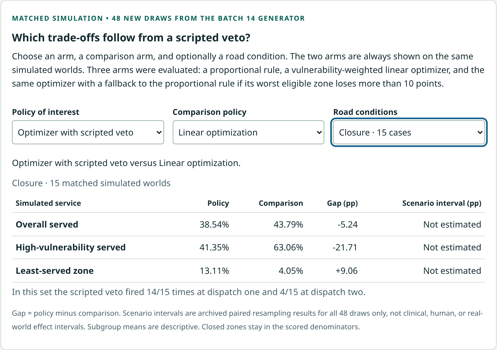

# F10 Offline decision support viewer under simulated road closure



**Suggested caption.** Figure F10. The offline research viewer after selecting *Linear optimization* as the comparator and *Closure* in the road-condition control. The table compares the optimizer with a scripted veto against the same optimizer without a veto on 15 matched simulated worlds. Positive gaps mean more simulated service under the veto. Subgroup intervals are not estimated. These are not observed aid or participant outcomes.

## Reproduce

Use Node 24 and the previously verified Linux browser runtime with Playwright 1.62.1 and `@sparticuz/chromium` 158.0.0 (the exact browser package pins are in the viewer's `browser_qa/package-lock.json`). The image source is the committed `research/submission_review/decision_support_v2/index.html` from the [review snapshot](https://github.com/leonmarienga/ML-thesis/blob/b951c7a4883400c0d69a04d71ec91290351267e3/research/submission_review/decision_support_v2/index.html). After the runtime is locally available, no network or deployment is needed.

```bash
node capture_f10.cjs /path/to/decision_support_v2/index.html \
  /path/to/browser-runtime F10-local.png F10-local.json
```

The script checks SHA-256 for the shipped HTML (`9ddf0fedf618e7e9e3df5a194890ecb1f88883d4a48a4917cba2d423f7e84203`) and the unpacked Chromium 158.0.8127.0 executable (`1f698044a68e18c1ce0cce74be25413f176806f19f15a44de5bb02cd578996af`), opens `file://`, sets the comparison and road condition with native keyboard events, verifies the 48-to-15 case filter and disappearance of all three interval estimates, and verifies the exact rendered rows. HTTP requests are blocked and zero were attempted; no page errors were observed.

The crop is the browser's native bounding-box screenshot of the scripted-veto section, with no overlay, compositing, CSS changes or retouching. The road control remains visibly keyboard-focused. At a 1000×900 CSS-pixel browser viewport and 2× device scale, the image is **1824×1286 px**. Two fresh captures of the exact local viewer were byte-identical; the screenshot was visually inspected for legibility. Font or OS changes may alter raster output across machines. For the evidence register, use `F10-capture.json` and `SHA256SUMS`.

The *Closure* group is selected by the fixture's road classification. It includes 15 worlds, not the full 48, and is not the same experiment as the separate Batch 14 policy frontier. This screenshot demonstrates a viewer state and one keyboard sequence. It does not certify accessibility, usable operational decision support, participant performance, or real relief effects.
